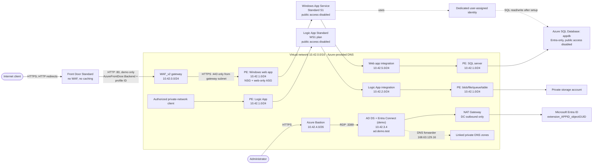

# Windows App Service behind Front Door and Application Gateway with private Logic Apps and demo AD

For step-by-step manual configuration of Front Door, Application Gateway, App Service, and SQL in Azure Portal, see [Azure Portal setup](AZURE-PORTAL-SETUP.md).

This azd project provisions:

- **Azure Front Door Standard without WAF**, with a managed HTTPS endpoint and HTTP-to-HTTPS redirect. Its only origin is the existing Application Gateway; caching is disabled.
- A **Windows App Service on a separate Standard S1 plan**, with public network access disabled and a private endpoint accepting HTTPS only from the Application Gateway subnet. Application Gateway WAF_v2 routes only to this web app over HTTPS.
- The gateway listener accepts application traffic only from `AzureFrontDoor.Backend`. Its existing WAF policy rejects missing or incorrect `X-Azure-FDID` headers, so only this Front Door profile is accepted. GatewayManager and Azure Load Balancer infrastructure traffic remain allowed.
- A dedicated **user-assigned managed identity** for that web app, plus outbound VNet integration and a **private Azure SQL logical server and Basic database** (`appdb`, 5 DTUs, 2 GiB). SQL uses Entra-only authentication, not passwords. An administrator-run setup script grants the app identity read/write data access without schema-management privileges.
- The existing Logic App Standard, Workflow Standard plan, private endpoint, VNet integration, and private storage. **There is no Application Gateway route to the Logic App.** It remains accessible to authorized private-network clients.
- Shared private DNS for App Service/Logic App and private DNS for blob, file, queue, and table storage.
- A Windows Server 2022 Desktop Experience VM (`Standard_D2s_v5`, 8 GB RAM), with a static private IP and no public IP. A VM extension installs AD DS and initiates creation of the **ad.demo.test** forest (`DEMO` NetBIOS name). A manual restart completes promotion.
- Azure Bastion Basic for browser RDP, plus NAT Gateway for explicit outbound connectivity from the DC to Windows Update and Entra. The DC subnet permits inbound RDP only from Bastion; it does not expose AD services to the application subnets.
- Log Analytics, Application Insights for the Logic App, diagnostic settings for Front Door/web app/gateway/Logic App/storage, and VM boot diagnostics.

**Provisioning does not configure your Entra tenant.** After the VM restart, prepare the directory and use the Entra Connect **Custom** wizard on that VM to select user `objectGUID` as a directory extension. Tenant sign-in and consent are deliberately interactive. This is a single-DC, colocated-sync-server **demo**, not a production identity deployment.

## Architecture



The original resource names are retained so incremental deployment adds Front Door and restricts ingress without replacing the Logic App or moving existing private endpoints. Both web hosts use the existing `privatelink.azurewebsites.net` zone; DNS zone groups also create SCM records.

### Enforced ingress chain

| Hop | Enforcement |
| --- | --- |
| Client to Front Door | Managed HTTPS on the generated endpoint; HTTP redirects to HTTPS. No Front Door WAF policy or security-policy association is created. |
| Front Door to Application Gateway | Gateway subnet NSG allows `AzureFrontDoor.Backend` on the configured listener port, preserves required `GatewayManager`/`AzureLoadBalancer` traffic, then denies all other inbound traffic, including VNet clients. The existing gateway WAF remains in Prevention mode and blocks missing or nonmatching `X-Azure-FDID`; matching requests still pass through its OWASP managed rules. |
| Application Gateway to Windows App Service | Public App Service access stays disabled. NSG policies are enabled on the existing private-endpoint subnet. Only the web app endpoint joins a dedicated application security group (ASG): allow TCP 443 from the gateway subnet, then deny all other inbound traffic to that ASG. |

The Front Door service tag alone would allow **any customer's Front Door**; the profile-ID check is also required. Conversely, a forged header alone cannot bypass the gateway NSG. App Service IP access restrictions are not used for this private hop because requests through private endpoints bypass them. The ASG limits the new endpoint rules to the Windows app; private Logic App, SQL, and storage access remain unchanged.

**Intentional access change:** direct gateway requests and direct private requests to the Windows app are no longer supported. The web app and its SCM/Kudu hostname share the same private endpoint IP and port, so SCM is also blocked from private deployment runners. No SCM route or deployment-runner exception is added; see [Web app and Logic App content](#web-app-and-logic-app-content).

## Prerequisites and costs

- Azure CLI with Bicep and Azure Developer CLI (`azd`).
- Permission to create global Front Door Standard resources (`Microsoft.Cdn` provider), plus quota for WAF_v2, Workflow Standard (two WS1 workers by default), Windows Standard App Service, D-series VMs, managed disks, private endpoints, Bastion, NAT Gateway, and Standard public IPs in the chosen region.
- A separate **test Entra tenant**, with a verified UPN domain and a directly assigned Hybrid Identity Administrator role for Connect setup. Do not attach this demo to a production tenant or run a second active Connect exporter for an existing tenant.
- For Graph verification: PowerShell with `Microsoft.Graph.Authentication`, consent for `Application.Read.All` and `User.Read.All`, and a supported role for listing extension definitions (for example, Cloud Application Administrator). This is separate from the Hybrid Identity Administrator role used for Connect setup.
- For SQL: an existing Entra administrator group (recommended) or user **in the Azure subscription's tenant**, separate from the web app identity. The provisioning identity must be allowed to configure SQL Entra-only authentication. Database setup requires PowerShell 7, current `Az.Accounts` and `SqlServer` modules (v22+ with SecureString access-token support), administrator sign-in, and a client connected to the VNet/private DNS.

Front Door Standard adds a base fee and usage charges; access/probe logs also contribute to Log Analytics ingestion. Bastion, NAT Gateway, the Windows VM/disks, the S1 plan, Azure SQL Basic, and private endpoints incur recurring charges. SQL Basic with local backup redundancy is a low-cost demo configuration, not a production availability/performance recommendation. No live region/quota validation is performed by these templates. Defaults assume three-zone support for the existing gateway/public IP; adapt `availabilityZones` for the selected region.

## Provision

Use the existing azd environment when modifying an existing deployment. **Keep its subscription, environment name, resource group, and location unchanged**; these participate in resource naming.

The same provision operation now creates Front Door and applies both ingress restrictions; no new required parameters, custom domain, or certificate inputs are needed. The existing HTTP gateway listener is retained as the Front Door origin. Expect a cutover interruption while the restrictions and Front Door configuration propagate; after provisioning, use `FRONT_DOOR_URL`, not the gateway FQDN. Stop direct web-app/SCM jobs before updating, and review the deployment limitation below. On an already customized environment, verify that no additional App Service private endpoints or deployment slots provide an alternate ingress path; incremental deployment does not remove out-of-template resources.

```powershell
azd auth login
# For a new environment only:
azd init --environment la-appgw-demo
azd env set AZURE_LOCATION swedencentral
# Existing group in the subscription's Entra tenant; these values are not secrets:
azd env set SQL_ADMIN_OBJECT_ID '<entra-group-object-id>'
azd env set SQL_ADMIN_LOGIN '<entra-group-display-name>'
azd env set SQL_ADMIN_PRINCIPAL_TYPE Group
```

For an individual administrator, use their object ID/display name and set `SQL_ADMIN_PRINCIPAL_TYPE` to `User`. `Group` is the default. Never use the app identity as the SQL administrator. These are Entra identities, not local AD accounts.

Provide two different strong passwords in process environment variables, not source control, command history, or `azd env set`. From PowerShell 7:

```powershell
$env:DC_ADMIN_PASSWORD = Read-Host 'VM/domain administrator password' -MaskInput
$env:DSRM_PASSWORD = Read-Host 'Separate DSRM recovery password' -MaskInput
try {
    azd provision --preview
    if ($LASTEXITCODE -ne 0) { throw 'Provision preview failed.' }
    # Review the preview before executing this line:
    azd provision
    if ($LASTEXITCODE -ne 0) { throw 'Provisioning failed.' }
}
finally {
    Remove-Item Env:\DC_ADMIN_PASSWORD, Env:\DSRM_PASSWORD -ErrorAction SilentlyContinue
}
```

The passwords are ARM `secureString` parameters; the DSRM value is sent only in the VM extension's protected settings. Keep them in an approved password vault for administration, recovery, and subsequent provisioning. Encoding in the extension is not encryption; Azure protected settings protect delivery, and local administrators can access extension artifacts. Do not log decoded settings.

Configurable defaults are in [main.bicep](infra/main.bicep), [resources.bicep](infra/resources.bicep), [domain-controller-network.bicep](infra/domain-controller-network.bicep), and [domain-controller.bicep](infra/domain-controller.bicep). Change the forest name/NetBIOS name **before the first deployment**, not to rename an existing forest. If changing the VNet range, also update both new subnet prefixes and the DC private IP in the network module.

### Retrying a subnet provisioning failure

`ReferencedResourceNotProvisioned` with a subnet in `Updating` and `PutSubnetOperation` indicates that a network consumer started while a subnet update was still running. Sibling subnet updates can affect the same VNet; depending only on the consumer's own subnet is not sufficient.

Subnet writes are serialized in this order: gateway, private endpoints, Logic App integration, web app integration, domain controller, Bastion. The final two subnets are provisioned in a network-only module. All private endpoints, both apps' VNet integration, Application Gateway, and the VM/Bastion module wait for this entire subnet phase. Private endpoint provisioning does not need to wait for DC promotion or Bastion creation.

If an earlier deployment failed:

1. Wait for existing deployments/network operations in the resource group to finish; do not start overlapping `azd provision` runs.
2. Check the VNet/subnet provisioning states in Azure portal. If `Updating` persists with no active deployment, inspect the Activity log and the operation failure before retrying.
3. Run `azd provision --preview`, review it, then `azd provision` using the **same environment** and the original passwords as described above. The corrected templates keep resource names and subnet settings unchanged; no deletion/recreation is required for this ordering fix.

Outputs:

| Output | Purpose |
| --- | --- |
| `FRONT_DOOR_URL`, `FRONT_DOOR_HOSTNAME` | HTTPS public entry point for the Windows web app and its generated hostname |
| `FRONT_DOOR_NAME`, `FRONT_DOOR_ID` | Profile name and generated `X-Azure-FDID` identifier (not an ARM resource ID or secret) |
| `APPLICATION_GATEWAY_FQDN`, `APPLICATION_GATEWAY_PUBLIC_IP` | Restricted Front Door origin; no longer a direct client entry point |
| `APP_SERVICE_NAME`, `APP_SERVICE_DEFAULT_HOSTNAME` | Windows web app and its private backend hostname |
| `WEB_APP_IDENTITY_NAME`, `WEB_APP_IDENTITY_PRINCIPAL_ID` | Database username and Entra object ID used by the SQL setup script |
| `WEB_APP_IDENTITY_CLIENT_ID` | Client ID used to select the identity for application token acquisition |
| `SQL_SERVER_FQDN`, `SQL_DATABASE_NAME`, `SQL_TENANT_ID` | SQL connection and administrator sign-in details |
| `LOGIC_APP_NAME`, `LOGIC_APP_DEFAULT_HOSTNAME` | Existing, private-only Logic App |
| `STORAGE_ACCOUNT_NAME` | Private Logic App runtime/content storage |
| `DOMAIN_CONTROLLER_NAME`, `DOMAIN_CONTROLLER_PRIVATE_IP`, `DOMAIN_CONTROLLER_NIC_NAME` | DC VM connection details |
| `AD_DOMAIN_NAME`, `BASTION_NAME` | New forest and Bastion host |

## Initialize web app database access

**Provisioning alone does not grant SQL data access.** Azure resource RBAC and attaching an identity do not create a contained database user. After provisioning, run [Initialize-WebAppDatabase.ps1](scripts/Initialize-WebAppDatabase.ps1) as the configured SQL Entra administrator (or a member of that administrator group) from a private-network administrative workstation. Do not temporarily open SQL to the Internet.

1. Obtain the SQL and identity outputs above using `azd env get-values` in the environment used to provision. Use `WEB_APP_IDENTITY_PRINCIPAL_ID` (object ID), **not** the client ID, for database user creation.
2. Confirm `SQL_SERVER_FQDN` resolves to the SQL private endpoint address and TCP 1433 is reachable from that workstation. If it uses custom DNS, configure forwarding for the linked private DNS zone. Always connect using the normal server hostname, not its private IP or `privatelink` hostname, so TLS hostname validation works.
3. Install current `Az.Accounts` and `SqlServer` modules on that workstation if missing. Sign in and run:

   ```powershell
   Connect-AzAccount -Tenant '<SQL_TENANT_ID>'
   .\scripts\Initialize-WebAppDatabase.ps1 `
       -ServerFqdn '<SQL_SERVER_FQDN>' `
       -DatabaseName 'appdb' `
       -IdentityName '<WEB_APP_IDENTITY_NAME>' `
       -IdentityPrincipalId '<WEB_APP_IDENTITY_PRINCIPAL_ID>' `
       -TenantId '<SQL_TENANT_ID>'
   ```

   The script creates an external contained user by SID, avoiding Microsoft Graph directory lookup permissions on the SQL server. It grants `CONNECT`, `db_datareader`, and `db_datawriter`: SELECT/INSERT/UPDATE/DELETE on existing and future user tables (and applicable views), but no CREATE/ALTER/DROP schema permissions, `db_owner`, or `db_ddladmin`. Keep schema creation/migrations in an administrator-controlled process. The database starts empty; no application tables are invented.

   Reruns are idempotent. A same-named user with a different SID/type causes an explicit failure, not reassignment or deletion. `Verified = True` confirms the expected SID and read/write role membership. The script does not remove pre-existing grants; review any manually elevated permissions separately.
4. Deploy application code that uses the configured identity and connection settings, then perform the live access checks below.

### Application connection settings

The web app has a **separate** user-assigned identity; the Logic App keeps its original identity and receives no SQL grants. Switching the web app from system-assigned to user-assigned removes its old system identity. Before updating a customized existing deployment, migrate any permissions assigned to that old principal.

The infrastructure configures:

| Setting | Usage |
| --- | --- |
| `AZURE_CLIENT_ID` | Select the web app's user-assigned managed identity with Azure SDK credentials |
| `SQL_SERVER_FQDN`, `SQL_DATABASE_NAME` | Server and database for drivers that acquire an access token explicitly |
| Connection string `MicrosoftDataSqlClient` (`SQLAzure`) | Microsoft.Data.SqlClient acquires a token for the web app's user-assigned identity using `Authentication=Active Directory Managed Identity` and `User Id=<client-id>` |
| Connection string `SystemDataSqlClient` (`SQLAzure`) | System.Data.SqlClient base connection string without `Authentication` or `User Id`; application code must supply `SqlConnection.AccessToken` |

Both connection strings use the same server/database, encryption, certificate validation, and a 30-second connection timeout. They replace `DefaultConnection`; update application lookups to the matching provider's name. For ASP.NET Core, read `Configuration.GetConnectionString("MicrosoftDataSqlClient")` or `Configuration.GetConnectionString("SystemDataSqlClient")`. For ASP.NET Framework, read the matching named entry from `ConfigurationManager.ConnectionStrings`. App Service exposes them as `SQLAZURECONNSTR_MicrosoftDataSqlClient` and `SQLAZURECONNSTR_SystemDataSqlClient`.

Use a current supported Microsoft.Data.SqlClient release (the client-ID behavior requires v3+). Microsoft.Data.SqlClient v7+ also requires its `Microsoft.Data.SqlClient.Extensions.Azure` package for Entra authentication.

System.Data.SqlClient does **not** support the managed-identity `Authentication` value. For that provider, use Azure.Identity to request a valid SQL token (`https://database.windows.net/.default` in Azure public cloud), explicitly selecting the user-assigned identity with the client ID in `AZURE_CLIENT_ID`. Assign the token to `SqlConnection.AccessToken` before opening each new connection. Reuse the credential for token caching/refresh, not an indefinitely cached token string. The base connection string alone does not authenticate; do not add a password or Windows integrated authentication.

Both paths require that identity to be attached to the resource actually hosting the application and its SQL user to be initialized. A connection-string change does not fix a missing identity assignment. Attaching an identity does **not** turn the IIS worker into a Windows domain account or enable Windows integrated SQL authentication.

Outbound VNet integration is distinct from the inbound web app private endpoint. The dedicated `10.42.5.0/24` integration subnet and SQL private DNS link provide the outbound SQL path; default private-address routing is sufficient. No new public SQL firewall exceptions or SQL passwords are created.

## Complete the domain controller

1. Wait for the resource deployment and `InstallDemoForest` VM extension to succeed. The extension deliberately **does not reboot inside the extension handler**.
2. In Azure portal, restart the VM identified by `DOMAIN_CONTROLLER_NAME`. Allow AD DS/DNS to start. Connect using **Connect > Bastion**, username `DEMO\demoadmin`, and the VM administrator password. The pre-promotion local administrator becomes the forest administrator.
3. Copy [Configure-DemoDirectory.ps1](scripts/Configure-DemoDirectory.ps1) to the VM (Bastion clipboard can be used to save the script). Run in elevated Windows PowerShell 5.1:

   ```powershell
   .\Configure-DemoDirectory.ps1 -VerifiedUpnSuffix 'your-verified-domain.example'
   ```

   Replace the placeholder with an actual domain verified in your test tenant. `ad.demo.test` is private and cannot be verified in Entra. The script adds the verified UPN suffix, creates the protected `SyncedDemoUsers` OU, configures DNS forwarding to `168.63.129.16`, and points the DC's DNS client to loopback. Azure retains control of the NIC's IP configuration; the VNet continues using Azure-provided DNS so the gateway and private endpoints do not depend on the demo DC.
4. In **Active Directory Users and Computers**, create a nonprivileged test user under `SyncedDemoUsers` and select the verified UPN suffix. Use a new test identity, not an existing production/cloud-only user that could be matched accidentally.
5. Confirm services, replication advertising and DNS:

   ```powershell
   Get-Service NTDS, DNS, Netlogon
   dcdiag /test:Advertising /test:SysVolCheck /test:DNS
   if ($LASTEXITCODE -ne 0) { throw 'Domain-controller health checks failed.' }
   Get-ADUser -Filter * -SearchBase 'OU=SyncedDemoUsers,DC=ad,DC=demo,DC=test' -Properties objectGUID, UserPrincipalName |
       Select-Object UserPrincipalName, objectGUID
   ```

AD database, logs, and SYSVOL reside on the uncached LUN 0 data disk (`F:`), not the ephemeral temporary disk. The bootstrap refuses to format an existing, unrecognized volume. Do not rerun promotion while a reboot is pending. Entra Connect's local database uses the persistent OS disk.

## Configure Entra Connect Sync and user objectGUID

Use **Microsoft Entra Connect Sync**, not Cloud Sync.

1. On the VM, download the current signed installer from **Entra admin center > Entra ID > Entra Connect > Connect Sync**. Verify its Microsoft signature and install the latest supported release. Microsoft requires **2.5.79.0 or later by September 30, 2026**; that is a minimum, not a recommendation to pin to that version. The Windows Server 2022 GUI image meets the OS/.NET prerequisites; keep it patched and TLS 1.2 enabled.
2. Select **Customize**, not Express settings. Sign in to the intended test Entra tenant with your Hybrid Identity Administrator account; supply the demo forest administrator when adding `ad.demo.test`. Do not store tenant credentials in the deployment or scripts.
3. Choose **Password Hash Synchronization** for this demo. Keep the supported default source-anchor selection; **do not change sourceAnchor/ImmutableId to implement this extension**.
4. At **Domain and OU filtering**, include only `SyncedDemoUsers`. Do not sync the whole forest, built-in administrator accounts, or the Domain Controllers OU. Check the verified user UPN suffix and resolve any warnings.
5. Under **Optional features**, enable **Directory extension attribute sync**.
6. On **Directory extensions**, search for **`objectGUID`** (case-sensitive), select the **User** attribute (`objectGUID (user)`), and move it to **Selected attributes**. Do not select the group attribute in place of the user attribute.
7. Finish initially in **staging mode**. Review the AD import, synchronization results, OU scope, and pending exports in Synchronization Service Manager. Staging mode does not export users, passwords, or extension values.
8. When satisfied this is the intended test tenant and there is no other active exporter, use the wizard's **Configure staging mode** task to disable staging. Enable the scheduler and run an initial cycle from elevated Windows PowerShell:

   ```powershell
   Import-Module ADSync
   Set-ADSyncScheduler -SyncCycleEnabled $true
   Start-ADSyncSyncCycle -PolicyType Initial
   ```

   A successful start is not proof of export: wait for the cycle and inspect import/synchronization/export results in Synchronization Service Manager.

The wizard owns the **Tenant Schema Extension App** and creates a directory extension named:

```text
extension_<TenantSchemaExtensionApp-appId-without-hyphens>_objectGUID
```

This is a **user directory extension**, with the AD binary GUID represented as Base64, not `extensionAttribute1`-`extensionAttribute15`, a custom security attribute, or `onPremisesImmutableId`. Do not create a second Graph extension manually or edit/clone the generated synchronization rules.

### Visibility in Entra and verification

On the synchronized user's page, inspect **Extensions**, where available in your Entra portal experience, for the `extension_..._objectGUID` value. Portal surfaces differ and might not render arbitrary directory extensions; the canonical check is the explicitly selected user property in Microsoft Graph. Directory extensions are top-level user properties in Graph, **not** entries returned by `/users/{id}/extensions` (that endpoint is for open extensions).

To verify the actual value, copy the test user's `objectGUID` from AD and run the following on an administrative workstation with the Graph authentication module installed:

```powershell
Connect-MgGraph -TenantId '<test-tenant-guid>' -Scopes 'Application.Read.All', 'User.Read.All' -ContextScope Process
.\scripts\Test-EntraObjectGuidExtension.ps1 `
    -TenantId '<test-tenant-guid>' `
    -UserId 'demo.user@your-verified-domain.example' `
    -ExpectedObjectGuid '<objectGUID-from-Get-ADUser>'
Disconnect-MgGraph
```

[Test-EntraObjectGuidExtension.ps1](scripts/Test-EntraObjectGuidExtension.ps1) discovers the synced extension definition, explicitly selects the user's property, confirms the user is synchronized, and compares it with the Base64 of AD's GUID bytes. It throws for a missing extension, missing value, wrong tenant, ambiguous definition, or mismatched GUID. `Verified = True` is the acceptance criterion, not just the presence of an extension definition.

## Web app and Logic App content

The Windows App Service initially serves the platform landing page through **`FRONT_DOOR_URL`**. The infrastructure supplies outbound VNet integration and SQL settings, but does not add web application code, end-user authentication, or domain membership. If App Service Authentication is enabled separately, `FRONT_DOOR_URL` instead starts its sign-in flow. The DC's inbound NSG restrictions remain unchanged.

For Microsoft Entra Easy Auth, add the exact `https://<FRONT_DOOR_HOSTNAME>/.auth/login/aad/callback` URI to the Entra app registration. Configure `authsettingsV2.properties.httpSettings.forwardProxy` with `convention = Custom` and `customHostHeaderName = X-Original-Host`; Application Gateway supplies that header from the Front Door-preserved public Host value. Verify the Entra authorization request's `redirect_uri` uses the full generated Front Door hostname, including its hash. The template does not own the Entra app registration or overwrite separately managed authentication-provider settings.

Front Door health probes are disabled because the origin group has one origin. The gateway probe accepts `200-399` and the expected Easy Auth `401`; accepting `401` proves backend reachability, not successful user authentication. Keep the public route uncached and validate the browser sign-in flow separately.

**Web app deployment limitation:** the gateway-only private endpoint rules also block direct SCM/Kudu deployment, even from a VNet-connected runner. Do not route SCM through the public Front Door or add a broad VNet exception: either would defeat the intended isolation. For future application deployment, use a separately designed pull-based deployment such as [run from an external package URL](https://learn.microsoft.com/azure/app-service/deploy-run-package#run-from-external-url-instead), with private package storage, app-identity read access, and reachable outbound networking. That package pipeline/storage/RBAC is not provisioned here; check the documented migration limitations for apps already running from a local ZIP package before choosing it.

The existing sample Logic App workflow remains under [src/logicapp](src/logicapp). Its private endpoint is **not** in the web app ASG, so its existing private SCM deployment still works from a private-network runner:

```powershell
.\scripts\deploy-logicapp.ps1
```

Do not temporarily enable public App Service/Logic App SCM access. Do not use the domain controller as a general-purpose CI/build runner outside this isolated demo.

## Acceptance checks

- From a VNet-connected client, both app hostnames and their SCM hostnames resolve to private endpoint addresses.
- Application Gateway **Backend health** shows the Windows web app healthy; the pool and probe hostname reference only `APP_SERVICE_DEFAULT_HOSTNAME`. The HTTPS probe accepts `200-399` and the expected Easy Auth `401`, but no other 4xx response.
- `https://<FRONT_DOOR_HOSTNAME>/` returns the Windows web app or starts its configured Entra sign-in flow; `http://<FRONT_DOOR_HOSTNAME>/` redirects to HTTPS. An Easy Auth authorization request must use the exact Front Door callback hostname. Old Logic App workflow paths through Front Door must not invoke Logic Apps. Front Door has no WAF/security-policy association and only the gateway origin; route caching and single-origin health probes are disabled.
- From an Internet client **and a VNet client**, a fresh request to `http://<APPLICATION_GATEWAY_FQDN>/` or its public IP cannot connect, even with `X-Azure-FDID: <FRONT_DOOR_ID>`. For example, `curl.exe --connect-timeout 10 --max-time 15 -H "X-Azure-FDID: <FRONT_DOOR_ID>" "http://<APPLICATION_GATEWAY_FQDN>/"` must fail to connect, not return application content. Use the configured listener port if changed from 80.
- The gateway WAF is still attached and in Prevention mode, with separate blocking rules for missing and incorrect `X-Azure-FDID`. If testing with a second, disposable Front Door profile, its request to the gateway must return **403** and a matching gateway firewall log, while this deployment's profile succeeds. Do not open the NSG temporarily to test header filtering.
- From a VNet-connected client outside the gateway subnet, fresh TCP 443 requests to `APP_SERVICE_DEFAULT_HOSTNAME` and its SCM hostname cannot connect, despite resolving privately. The web private endpoint is the only member of its ASG, the private-endpoint subnet has `NetworkSecurityGroupEnabled`, and its NSG allows the gateway subnet then denies all other traffic to that ASG. Test new connections after NSG propagation, not previously established sessions.
- Direct public access to **both** app default hostnames/SCM is blocked. The Logic App remains callable through its private endpoint with its normal authorization, and its private SCM endpoint remains available to the private runner.
- SQL public access is disabled and Entra-only authentication is enabled. From the web app's private-network context, `SQL_SERVER_FQDN` resolves to the SQL private endpoint.
- SQL setup reports `Verified = True`. Have the SQL administrator create a disposable test table; from the **deployed web app using its managed identity**, run SELECT/INSERT/UPDATE/DELETE inside a transaction and roll it back. Confirm CREATE TABLE/ALTER TABLE fail for that identity, then have the administrator remove the test table. An administrator connection or local mock test is not proof of application access.
- The DC has no public IP, browser RDP works only through Bastion, `dcdiag` succeeds after restart, and Entra Connect exports the test OU.
- The extension verification script reports the exact AD GUID match.

Local, non-deploying validation:

```powershell
az bicep build --file .\infra\resources.bicep
az bicep build --file .\infra\main.bicep --outfile "$env:TEMP\la-appgw-main.json"
.\tests\Test-Changes.ps1 -CompiledTemplatePath "$env:TEMP\la-appgw-main.json"
```

[resources.json](infra/resources.json) is generated from Bicep; do not edit it manually. The local tests validate the two provider-specific SQL connection strings and the compiled ingress configuration, including no Front Door WAF, route/origin dependencies, service-tag and profile-ID filtering, private-endpoint NSG enforcement, and isolation from unrelated endpoints. Compilation and mock tests cannot establish live ingress denials, Azure backend health, live SQL identity/table access, successful AD promotion, or tenant synchronization; run the live checks above after provisioning/setup.

## Security and production limitations

- Front Door terminates client HTTPS, but **Front Door to Application Gateway remains HTTP** to preserve the existing certificate-free demo listener. This is **not end-to-end TLS**: do not transmit credentials or sensitive data. Before using authentication, add a publicly trusted certificate-backed HTTPS gateway listener, then switch the Front Door origin/probe to HTTPS, adjust its port and NSG rule, and retain certificate name validation.
- Front Door deliberately has **no WAF**. The existing Application Gateway WAF is retained both for OWASP protection and origin profile-ID enforcement; do not disable it or add a custom Allow rule that short-circuits these checks.
- Private endpoints remove public reachability, not application authorization. Only the gateway subnet can reach the Windows app endpoint; other authorized private-network clients can still access the separate Logic App endpoint. No new deployment-runner exception or additional web-app private endpoint is included.
- This is not a production identity architecture: one DC, one site, no AD-aware backup or recovery automation, and Connect colocated with AD DS. Use redundant DCs, a dedicated hardened Connect server, backup/recovery, restricted administrative access, monitoring, and controlled outbound access for production.
- The DC NSG blocks other VNet inbound traffic. Adding domain-joined machines requires explicitly scoped AD/DNS rules; do not broadly open directory services to the application subnets or Internet.
- NAT provides outbound translation, not URL filtering. Allow required Microsoft endpoints if adding an egress firewall.
- Storage public and anonymous access remain disabled. Shared keys remain enabled for Logic App content-share compatibility; runtime traffic stays private.

## References

- [Secure Front Door origins with service tags and profile-ID checks](https://learn.microsoft.com/azure/frontdoor/origin-security)
- [Application Gateway WAF missing-header and Front Door rules (examples 6 and 7)](https://learn.microsoft.com/azure/web-application-firewall/ag/create-custom-waf-rules)
- [Private endpoint application security groups](https://learn.microsoft.com/azure/private-link/configure-asg-private-endpoint)
- [Private endpoint NSG policy enforcement](https://learn.microsoft.com/azure/private-link/disable-private-endpoint-network-policy)
- [Front Door health probe behavior](https://learn.microsoft.com/azure/frontdoor/health-probes)
- [App Service with Application Gateway](https://learn.microsoft.com/azure/application-gateway/configure-web-app)
- [App Service private endpoints (including Standard plans)](https://learn.microsoft.com/azure/app-service/overview-private-endpoint)
- [App Service VNet integration](https://learn.microsoft.com/azure/app-service/overview-vnet-integration)
- [SQL managed identity authentication with Microsoft.Data.SqlClient](https://learn.microsoft.com/sql/connect/ado-net/sql/azure-active-directory-authentication)
- [CREATE USER and external SID/type syntax](https://learn.microsoft.com/sql/t-sql/statements/create-user-transact-sql)
- [Invoke-Sqlcmd with Entra access tokens](https://learn.microsoft.com/powershell/module/sqlserver/invoke-sqlcmd)
- [Install-ADDSForest](https://learn.microsoft.com/powershell/module/addsdeployment/install-addsforest)
- [Entra Connect prerequisites](https://learn.microsoft.com/entra/identity/hybrid/connect/how-to-connect-install-prerequisites)
- [Entra Connect directory extensions and supported wizard configuration](https://learn.microsoft.com/entra/identity/hybrid/connect/how-to-connect-sync-feature-directory-extensions)
- [Microsoft example selecting user objectGUID](https://learn.microsoft.com/entra/identity/saas-apps/cisco-user-management-for-secure-access-provisioning-tutorial#step-2-import-objectguid-attribute-via-microsoft-entra-connect-optional)
- [Graph directory-extension discovery](https://learn.microsoft.com/graph/api/application-list-extensionproperty?view=graph-rest-1.0)
