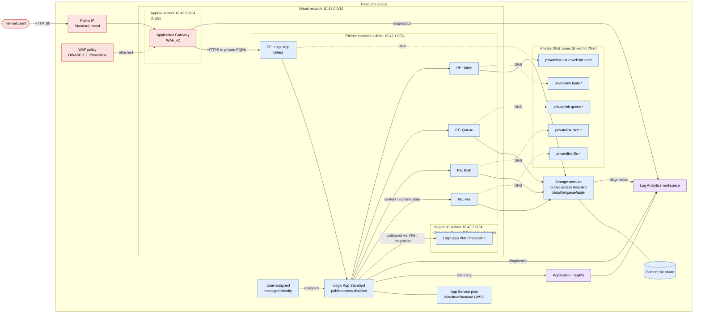

# Logic App Standard behind Application Gateway

This azd project provisions a private Azure Logic App Standard environment:

- Logic App Standard runs on a Workflow Standard App Service plan with public network access disabled.
- The Logic App has a private endpoint in the virtual network.
- The storage account has public network access disabled and private endpoints for blob, file, queue, and table.
- Private DNS zones are linked to the virtual network for Azure Websites and Storage private link names.
- Application Gateway WAF_v2 is the only public entry point and routes to the Logic App private endpoint over HTTPS.
- Log Analytics, Application Insights, and diagnostic settings are enabled for the main runtime path.

## Architecture



## Prerequisites

- Azure CLI
- Azure Developer CLI (`azd`)
- An Azure subscription with quota for Application Gateway WAF_v2, Workflow Standard Logic Apps, Storage, private endpoints, and Public IPs.

This project was checked against the default subscription for `eastus2`, `westus2`, and `centralus`; `eastus2` is the recommended default.

On Windows, install `azd` with:

```powershell
winget install Microsoft.Azd
```

The Logic App Standard plan defaults to two `WorkflowStandard` workers. If `azd provision --preview` reports `SubscriptionIsOverQuotaForSku` for `WorkflowStandard VMs`, request quota for the selected region or lower `logicAppPlanCapacity` in `infra/resources.bicep` for a non-production demo.

## Deploy

```powershell
azd auth login
azd init --environment la-appgw-demo
azd env set AZURE_LOCATION swedencentral
azd provision --preview
azd provision
```

The deployment outputs include:

- `APPLICATION_GATEWAY_FQDN`
- `APPLICATION_GATEWAY_PUBLIC_IP`
- `LOGIC_APP_DEFAULT_HOSTNAME`
- `LOGIC_APP_NAME`
- `STORAGE_ACCOUNT_NAME`

## Workflow content

The infrastructure deployment creates the Logic App Standard host. A small sample workflow is included under `src/logicapp`.

Because the Logic App public endpoint and SCM/Kudu endpoint are disabled, deploy workflow content from a runner that has private network connectivity to the virtual network, such as a VM, VPN-connected workstation, or self-hosted CI runner:

```powershell
./scripts/deploy-logicapp.ps1
```

Keeping app deployment private is intentional: temporarily enabling public SCM access would break the "Application Gateway only" exposure requirement.

## Security notes

- Storage public access and anonymous blob access are disabled.
- Storage data plane traffic from the Logic App is routed through private endpoints and private DNS.
- The Logic App public endpoint is disabled; inbound traffic is through Application Gateway only.
- Application Gateway uses WAF_v2 in Prevention mode with OWASP 3.2 rules.
- The storage account keeps shared key access enabled because Logic App Standard content storage uses an Azure Files content share connection string. The storage network path remains private.
